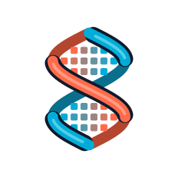

<div align="center">



<p>
  <b>The Minecraft: Bedrock Edition protocol in Go</b><br>
  Every packet, NBT, login and connections, matched to BDS
</p>

[-black)](https://feedback.minecraft.net/hc/en-us/sections/360001186971-Release-Changelogs)
[](info.go)
[](https://go.dev/)
[](LICENSE)
[](STATUS.md)
[](https://discord.gg/Fbmc69Gqr7)

</div>

## How it is checked

Packets are checked against the packet schemas dumped from a running BDS 1.26.60 (every packet, its
fields in wire order, enums and their values) and against Mojang's bedrock-protocol-docs. Login and
token checks follow the decompiled BDS. The decompiled code is **not** in this repo; it was only
used to read how the game works.

## Why protocol?

Helix needs a protocol library that matches what BDS sends and accepts, not one shaped around a
client or proxy. protocol is part of [Helix](https://github.com/helix-bedrock), a source-available
Bedrock server engine in Go, but it is a plain library that any Go project can use.

## Quick Start

```shell
go get github.com/helix-bedrock/protocol
```

## Packages

| Package | What it has |
|---|---|
| `protocol` (root) | Reader and writer for every protocol type (the "io" layer) |
| [`packet`](packet) | Every packet, the pool, batch encoder/decoder, compression and encryption |
| [`login`](login) | Login request parsing and client data |
| [`auth`](auth) | Verifies login tokens like BDS: discovery as a dedicated server, OpenID keys, corrected clock, BDS's disconnect reasons |
| [`nbt`](nbt) | Network and little-endian NBT |
| [`conn`](conn) | Packet connections over Helix [raknet](https://github.com/helix-bedrock/raknet) and [nethernet](https://github.com/helix-bedrock/nethernet): batching, compression, encryption, hooks |
| [`version`](version) | The `Protocol` interface for older Minecraft versions, `Latest`, and `Set`. Adapters live in their own repo |
| [`cmd/protodef`](cmd/protodef) | Writes a ProtoDef schema of every packet, in the `protocol.json` format of minecraft-data. The current one is [`schema/protocol.json`](schema/protocol.json): after a push to `main` changes it, a workflow opens a pull request with the new one |

## Roadmap

What works today and what is left is in [STATUS.md](STATUS.md).

| Part | State |
|---|---|
| Packets, reader and writer for protocol 2225 | ✅ done |
| NBT (network and little-endian) | ✅ done |
| Login and token verification as BDS does it | ✅ done |
| Connections over raknet and nethernet | ✅ done |
| Multi-version adapters | 🟡 interface done; adapters in their own repo |

**The goal is to match the latest Minecraft version exactly.** After that, every time Minecraft
updates, protocol will be updated to the new version. The project is maintained.

## Contributing

- **Found a bug or a difference from vanilla?** Open an [issue](https://github.com/helix-bedrock/protocol/issues)
- **Want to contribute code?** Read the [contributing guide](https://github.com/helix-bedrock/.github/blob/main/CONTRIBUTING.md)
  and the [AI policy](https://github.com/helix-bedrock/.github/blob/main/AI_POLICY.md)

## Credits

Imported from [gophertunnel](https://github.com/HashimTheArab/gophertunnel) by **Sandertv**, using the
fork by **HashimTheArab** at commit [`80c811b61860`](https://github.com/HashimTheArab/gophertunnel/commit/80c811b61860).
It is MIT licensed; the original license is in [`licenses/gophertunnel-LICENSE`](licenses/gophertunnel-LICENSE).
Helix maintains this code from here on. See [CREDITS.md](CREDITS.md).

## License

Noncommercial use only: [PolyForm Noncommercial 1.0.0](LICENSE) with Helix's
[extra permissions](ADDITIONAL-PERMISSIONS.md). Anyone may use it, run servers with it
(even ones that make money) and sell their own plugins, but nobody may sell Helix or its
code. Helix's game behaviour is re-engineered from Minecraft's Bedrock Dedicated Server;
see [NOTICE.md](NOTICE.md). Not an official Minecraft product. Not approved by or
associated with Mojang or Microsoft.

The initial import from gophertunnel keeps its MIT license; see [CREDITS.md](CREDITS.md)
and [`licenses/`](licenses).
