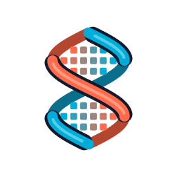

<div align="center">



<p>
  <b>The Minecraft: Bedrock Edition protocol in Go</b><br>
  Every packet, NBT, login and connections, matched to BDS
</p>

[-black)](https://feedback.minecraft.net/hc/en-us/sections/360001186971-Release-Changelogs)
[](info.go)
[](https://go.dev/)
[](LICENSE)
[](#status)

</div>

## Status

Status as of 2026-10-31: **in development**, at protocol 2225 (Minecraft 1.26.60).

- `login` turns client data into the skin other players are sent.
- `auth` verifies login tokens the way BDS 1.26.60 does, with the clock corrected from Microsoft's
  servers.
- NBT compounds are written with sorted keys, as BDS writes them.

What is left:

- **Multi-version support:** the `version` package has the interface; the adapters for older
  versions live in their own repo.
- **The API is not stable yet.** Names and behaviour may still change between commits.

## How it is checked

Packets are checked against the packet schemas dumped from a running BDS 1.26.60 (every packet, its
fields in wire order, enums and their values) and against Mojang's bedrock-protocol-docs. Login and
token checks follow the decompiled BDS. The decompiled code is **not** in this repo; it was only
used to read how the game works.

## Why protocol?

Helix needs a protocol library that matches what BDS sends and accepts, not one shaped around a
client or proxy. protocol is part of [Helix](https://github.com/helix-bedrock), an open-source
Bedrock server engine in Go, but it is a plain library that any Go project can use.

## Quick Start

```shell
go get github.com/helix-bedrock/protocol
```

## Packages

| Package | What it has |
|---|---|
| `protocol` (root) | Reader and writer for every protocol type (the "io" layer) |
| [`packet`](packet) | Every packet, the pool, batch encoder/decoder, compression and encryption |
| [`login`](login) | Login request parsing and client data |
| [`auth`](auth) | Verifies login tokens like BDS: discovery as a dedicated server, OpenID keys, corrected clock, BDS's disconnect reasons |
| [`nbt`](nbt) | Network and little-endian NBT |
| [`conn`](conn) | Packet connections over Helix [raknet](https://github.com/helix-bedrock/raknet) and [nethernet](https://github.com/helix-bedrock/nethernet): batching, compression, encryption, hooks |
| [`version`](version) | The `Protocol` interface for older Minecraft versions, `Latest`, and `Set`. Adapters live in their own repo |

## Roadmap

| Part | State |
|---|---|
| Packets, reader and writer for protocol 2225 | ✅ done |
| NBT (network and little-endian) | ✅ done |
| Login and token verification as BDS does it | ✅ done |
| Connections over raknet and nethernet | ✅ done |
| Multi-version adapters | 🟡 interface done; adapters in their own repo |

**The goal is to match the latest Minecraft version exactly.** After that, every time Minecraft
updates, protocol will be updated to the new version. The project is maintained.

## Contributing

- **Found a bug or a difference from vanilla?** Open an [issue](https://github.com/helix-bedrock/protocol/issues)
- **Want to contribute code?** Read the [contributing guide](https://github.com/helix-bedrock/.github/blob/main/CONTRIBUTING.md)
  and the [AI policy](https://github.com/helix-bedrock/.github/blob/main/AI_POLICY.md)

## Credits

Imported from [gophertunnel](https://github.com/HashimTheArab/gophertunnel) by **Sandertv**, using the
fork by **HashimTheArab** at commit [`80c811b61860`](https://github.com/HashimTheArab/gophertunnel/commit/80c811b61860).
It is MIT licensed; the original license is in [`licenses/gophertunnel-LICENSE`](licenses/gophertunnel-LICENSE).
Helix maintains this code from here on. See [CREDITS.md](CREDITS.md).

## License

protocol is licensed under [MIT](LICENSE).
